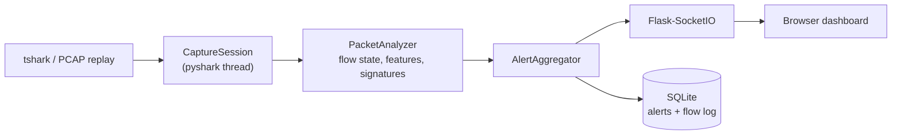

# Network IDS Dashboard

[](https://github.com/KarimSec811/ids-dashboard/actions/workflows/ci.yml)
[](https://karimsec811.github.io/ids-dashboard/demo/)

A network intrusion-detection sensor that tracks **TCP connection state** instead of judging packets one by one, so a SYN flood, a port scan and an IP sweep each raise **one explainable alert** with ATT&CK mapping, evidence and a downloadable PCAP. It comes with a live dashboard, replayable demo captures, and an honest list of what it misses.

**[Try the live demo](https://karimsec811.github.io/ids-dashboard/demo/)** (no install: a recording of the real dashboard replaying `demo_mixed.pcap`)

<!-- Add a 10-20 s screen recording here once recorded:   -->

## What it detects

| Alert | ATT&CK | How it is decided |
|---|---|---|
| `neptune` (SYN flood) | T1498 / T1499 | Many connections to one host that never completed the TCP handshake, *and* they dominate recent traffic to it (a busy server is not a flood) |
| `portsweep` | T1046 | Distinct ports on one host probed with **failed** attempts (refused, reset, or unanswered after a grace period) |
| `ipsweep` | T1046 | Distinct hosts probed by one source with failed attempts |

A set of NSL-KDD-style signatures (`smurf`, `teardrop`, `guess_passwd`, ...) is also available through `config.json`. It is kept for compatibility and experimentation; it is not what the sensor's accuracy rests on.

Every alert carries `reasons` (why it fired), `evidence` (the feature values), and the number of events, flows and sources it aggregates.

## How it works



- **Connection state, not packet flags.** `ConnState` follows each TCP connection through handshake and teardown (S0, S1, SF, REJ, RSTO, ...). Flows are oriented by the SYN, so a capture that starts mid-connection still knows who the client is.
- **Bounded memory.** Time windows, per-source probe history and the flow table are pruned, so a spoofed flood cannot exhaust the sensor.
- **Scoring ignores conditions that cannot fail.** Counters are lower-bounded only, so a bigger flood never scores as a smaller one.
- **One alert per attack, not per packet.** Alerts are grouped per attacker/victim pair (or per victim for floods) inside a cooldown window.

## Results with real attack tools

`eval/run_netns_lab.sh` builds a virtual lab (a Metasploitable-style victim with 17 services), attacks it with **real nmap, masscan, hping3 and fping**, replays each capture through the sensor and scores it against ground truth. Full table: [docs/EVALUATION.md](docs/EVALUATION.md).

| Scenario | Result |
|---|---|
| nmap SYN / connect / FIN / XMAS scans, masscan (1,000 ports) | detected, **1 alert each**, within 0.1-0.2 s |
| nmap `-T2` polite scan | detected, 1 alert, 2.5 s |
| nmap ping sweep, fping sweep (routed hosts) | detected, 1 alert, 2.0-2.6 s |
| hping3 SYN flood, from a real host and with spoofed sources | detected, 1 alert each |
| FTP password guessing | detected (`guess_passwd`), 1 alert |
| 300 parallel HTTP requests, a service tour of 7 ports, a small admin scan, ping | **0 alerts** |
| nmap `-T1` (one probe every 15 s), UDP scan, SYN flood to a closed port | missed, by design (see Limitations) |

> **Development set, not a final test.** The first run with real tools missed a single-host `hping3` flood: the attacker's own kernel resets every SYN-ACK, so connections never looked half-open. That is fixed (with two regression tests) and recorded in the report's findings log. Because the engine was corrected while building this evaluation, these numbers are optimistic. The unbiased test is the same scripts run once in a VM lab (Kali against Metasploitable), with Zeek and Suricata as baselines: the harness is ready, see [eval/README.md](eval/README.md).

## Results on synthetic PCAPs

Measured on the labelled captures generated by `tests/make_pcaps.py`: alerts raised by the first version of this project (per-packet signature matching) against the current engine.

| Scenario | First version | Now |
|---|---|---|
| Normal web traffic (1,176 packets, 6 parallel connections per page load) | 63 false `neptune` alerts | 0 |
| One client browsing 25 different servers | 105 false `ipsweep` alerts | 0 |
| SYN flood from spoofed sources (600 packets) | 141 `neptune` alerts | 1 aggregated alert (589 events, ~590 sources) |
| Port scan, 60 ports (121 packets) | 57 alerts | 1 |
| IP sweep, 40 hosts (41 packets) | 37 alerts | 1 |

> **Read this before trusting the table:** these captures are synthetic and were written with the same assumptions as the detectors, so this shows regressions are fixed, not that the sensor works on real networks. Evaluation on real traffic against Zeek and Suricata is the next milestone (see Roadmap).

## Quick start

```bash
git clone https://github.com/KarimSec811/ids-dashboard && cd ids-dashboard
python -m venv .venv && source .venv/bin/activate     # Windows: .venv\Scripts\activate
pip install -r requirements.txt                       # Wireshark/tshark must be installed
python app.py                                         # http://127.0.0.1:5000
```

Choose `demo_mixed.pcap` under **Sample capture...** and click **Replay**. This needs no capture privileges. For live capture, set the interface in **Settings** (it needs capture privileges: Administrator/root, or `CAP_NET_RAW` for dumpcap).

The demo PCAPs ship in `test_pcaps/`; regenerate them with `python tests/make_pcaps.py` (needs scapy).

## Configuration and tuning

`config.json` holds the interface, the detection thresholds and the signatures. Every number has a documented reason, and
`python eval/lint_config.py` checks the file (unknown fields, contradictory rules, MITRE ids that do not match their names,
thresholds below what TCP does on a healthy network). Three NSL-KDD-derived signatures ship enabled (`neptune`, `smurf`,
`guess_passwd`); the others are kept, disabled, with the measured reason. See [docs/TUNING.md](docs/TUNING.md) for sources,
profiles (sensitive / balanced / conservative) and how to tune on your own traffic.

## Security design

- Binds to `127.0.0.1` by default. A non-loopback bind is refused unless `IDS_API_TOKEN` is set (or `IDS_ALLOW_INSECURE=1`).
- With a token, settings changes, start/stop/acknowledge, and evidence-PCAP export require it.
- Settings are allow-listed and range-checked (an unvalidated settings endpoint is an IDS-evasion primitive: a BPF filter that hides the attacker).
- Everything that comes from the network (reverse DNS, DNS names, SNI) is escaped in the UI and stripped of control characters on the server. CSV export neutralises spreadsheet formulas.
- Replay files are selected by bare file name inside `test_pcaps/` only. Evidence-PCAP filters are built only from validated IPs and integers.
- Reverse DNS defaults to internal addresses only, so the sensor does not tip off an attacker's DNS server.

## Limitations

- **Validated against real attack tools in a virtual lab (a development set), not yet on a held-out lab or production traffic.** Nothing here has seen a real network's background noise beyond the short benign scenarios.
- **Throughput is a few hundred to ~1,500 packets/s**, limited by pyshark/tshark parsing. The detection engine itself takes ~0.5 ms per packet. This is a learning-grade sensor, not a line-rate one.
- **Evasions that work today:** slow scans below the probe window, scans distributed across many sources, and anything encrypted (payload heuristics only run on cleartext protocols).
- **Sweeps of dead hosts on a flat Ethernet segment are invisible**: the probes stop at ARP and never become IP packets (Zeek's scan detection has the same blind spot). Only routed or IP-level sweeps are seen.
- **The sensor's clock follows packets.** An unanswered probe is declared failed when a later packet arrives, so a completely silent link delays that alert.
- **A flood of SYNs to a closed port** (answered with RST) is not reported as a SYN flood.
- Live-capture alerts have no stored packets: the "evidence PCAP" records the *next* packets between the same hosts. Alerts from a replayed capture get the exact packets.
- It is not a replacement for Zeek or Suricata.

## Roadmap

1. Held-out evaluation in a VM lab (Kali against Metasploitable) with Zeek and Suricata baselines, plus a one-hour benign soak to measure false positives per hour. The harness is ready: `eval/README.md`.
2. Threat model and one detection card per detector (logic, tuning, expected false positives, evasions).
3. SIEM output (JSONL/CEF) with Wazuh decoder and rules.

## Repository layout

```
app.py                  Flask + Socket.IO entry point (routes, events, background services)
ids/engine.py           flow state, features, signatures, alert aggregation
ids/capture.py          live capture and PCAP replay (pyshark)
ids/intel.py            IOC matching, reverse DNS, optional GeoIP
ids/store.py            SQLite persistence (alerts, flow log)
ids/settings.py         validated config.json updates
templates/, static/     dashboard (plain HTML/CSS/JS, no build step)
tests/                  engine, golden-PCAP and web-layer tests
eval/                   evaluation harness: scenarios, lab runner, scoring, results/ (PCAPs + ground truth)
tools/build_demo.py     builds the static live demo into docs/demo/
API.md                  Socket.IO events, HTTP routes, alert/flow schemas
```

## Tests

```bash
python tests/make_pcaps.py && python -m pytest tests -q      # 56 tests, ~40 s, needs tshark
sudo eval/run_netns_lab.sh                                   # real attack tools in a virtual lab, ~10 min (Linux)
```

The golden tests replay every labelled PCAP through the real tshark pipeline and assert the exact alerts. If you change a detector, they tell you what moved.

Rebuild the live demo after changing the UI: `python tools/build_demo.py`.

---

Built by Kareem ([@KarimSec811](https://github.com/KarimSec811)).
